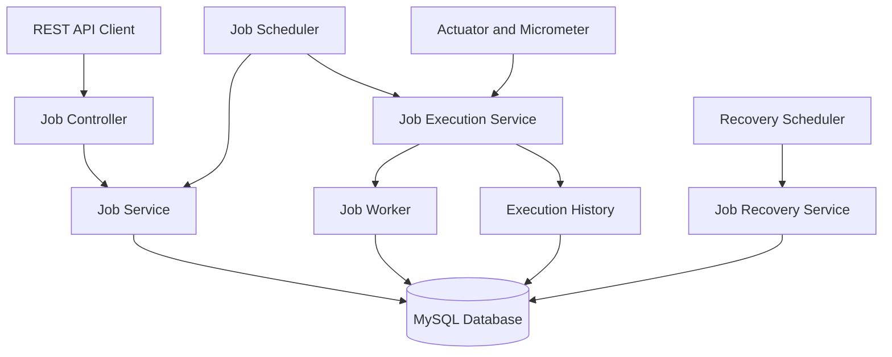

# TaskFlow — Distributed Job Scheduling and Execution Platform

TaskFlow is a backend application built with Java and Spring Boot for scheduling and executing background jobs. It demonstrates job lifecycle management, failure handling, retries, execution history, and operational monitoring.

## Features

- **REST APIs:** Create, retrieve, and inspect scheduled jobs.
- **Background scheduling:** Automatically discovers jobs that are ready for execution.
- **Atomic job claiming:** Uses database-level claiming to help prevent multiple workers from executing the same job.
- **Retry mechanism:** Retries failed jobs with exponential backoff and configurable attempt limits.
- **Failure recovery:** Detects stale running jobs and recovers them.
- **Execution history:** Tracks individual execution attempts, statuses, timestamps, and errors.
- **Input validation:** Validates API requests and returns centralized error responses.
- **Monitoring:** Exposes application health and job execution metrics.
- **Containerization:** Runs the application and MySQL using Docker Compose.

## Tech Stack

- Java 21
- Spring Boot
- Spring Data JPA / Hibernate
- MySQL
- Maven
- Docker and Docker Compose
- Spring Boot Actuator and Micrometer
- JUnit and Mockito

## Architecture



## API Endpoints

| Method | Endpoint | Description |
|---|---|---|
| POST | `/api/jobs` | Create a job |
| GET | `/api/jobs` | Retrieve jobs |
| GET | `/api/jobs/{id}` | Retrieve a job by ID |
| GET | `/api/jobs/{id}/history` | Retrieve execution history |
| GET | `/actuator/health` | Check application health |

## Example Request

Create a job using `POST /api/jobs`. The JSON fields should match the `JobRequestDTO` implemented in this repository.

Example structure (adjust field names and values to match the DTO):

```json
{
  "name": "sample-email-job",
  "type": "SEND_EMAIL"
}
```

## Run with Docker Compose

### Prerequisites

- Docker Desktop
- Git

### Start the application

Clone the repository:

```bash
git clone https://github.com/cherrish-sam/Taskflow.git
cd Taskflow
```

Configure the database password in a local `.env` file, using the variable expected by `compose.yaml`:

```dotenv
DB_PASSWORD=your_local_password
```

Keep `.env` private. Never commit database passwords or other secrets.

Start the services:

```bash
docker compose up --build
```

Check application health:

```bash
curl http://localhost:8080/actuator/health
```

Stop the services with:

```bash
docker compose down
```

## Run Tests

Run the test suite using Maven Wrapper:

```bash
./mvnw clean test
```

Tests requiring a database need the appropriate database configuration.

## Engineering Concepts Demonstrated

- REST API design and request validation
- Database-backed job scheduling
- Atomic state transitions and job claiming
- Retry policies and exponential backoff
- Recovery from interrupted executions
- Execution audit history
- Unit testing and application monitoring
- Containerized development environments

## Future Improvements

- Distributed locking and multi-instance coordination
- Dead-letter queue for permanently failed jobs
- Job priorities and configurable concurrency
- Authentication and authorization
- Integration tests using Testcontainers
- CI/CD pipeline

## Author

Cherrish Sam Gladson

